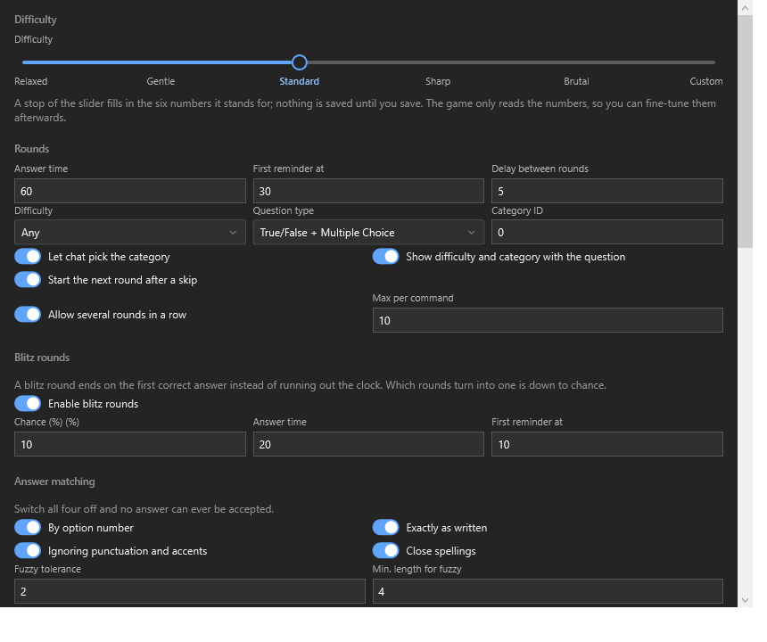
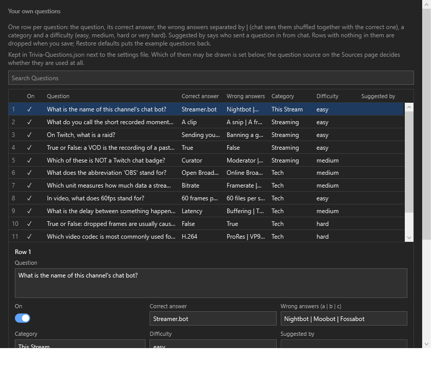
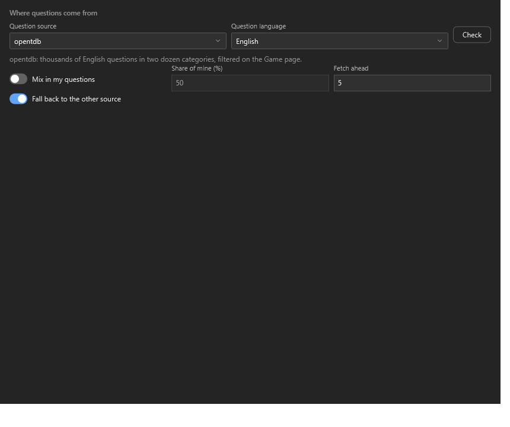
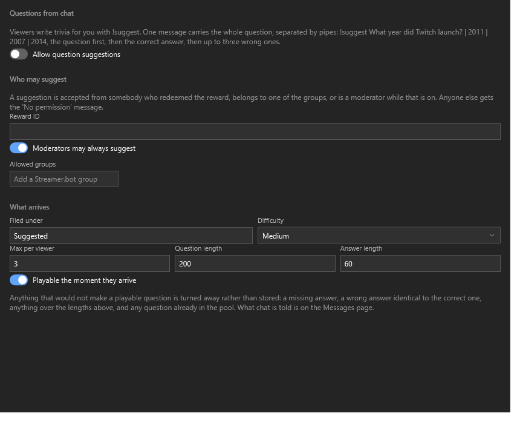
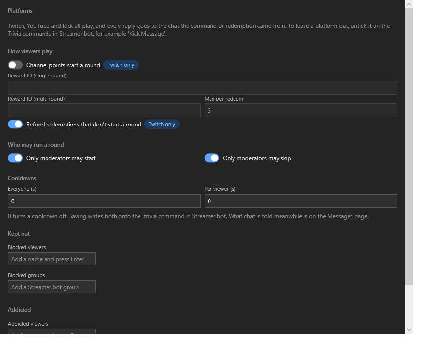
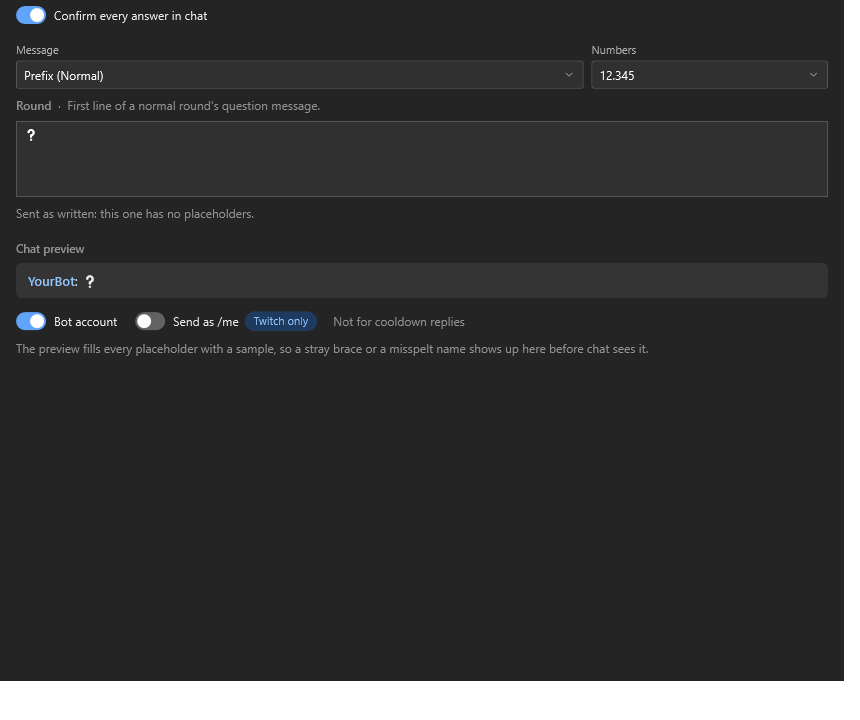
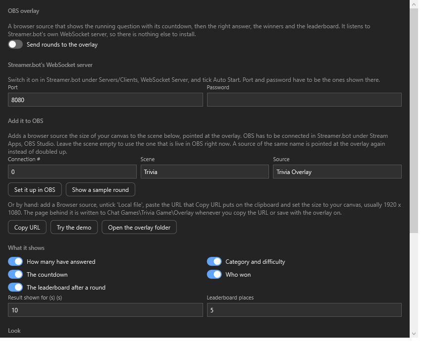
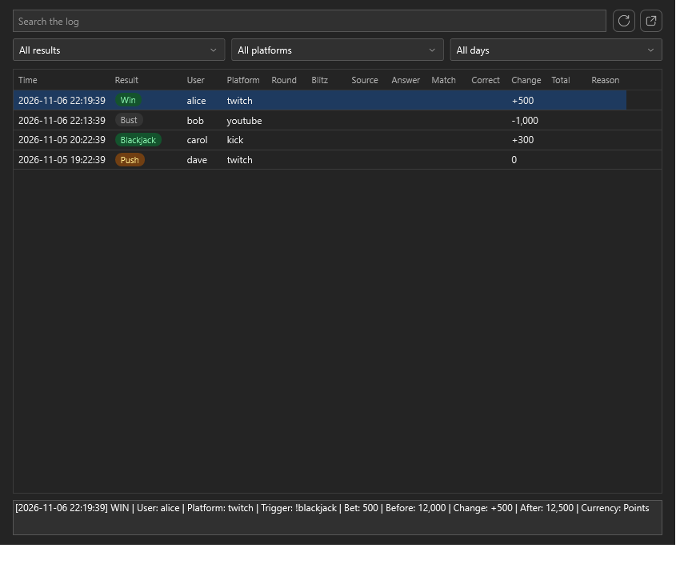

# Import
<p align="center"> </p>

Click `Import` in [streamer.bot](https://streamer.bot/) and drag the [TriviaGame.sb](https://github.com/aaskjer/Trivia-Game/releases) file into the window, or paste the [import string](https://github.com/aaskjer/Trivia-Game/blob/main/Import-String.md).

<p align="center"></p>

Click `Import`, then `Yes` on both popups that follow.

## Enable Commands
<p align="center"></p>

The commands ship disabled. Enable all of them, or the parts that depend on them stay silent.

# Setup
<p align="center"></p>

Go to `Actions`, select `[TG] - Settings`, right-click the `Test` trigger and choose `Test Trigger`. That opens the settings window. The first time, it fetches `UIFramework.dll` from GitHub (the window is [UIFramework for streamer.bot](https://github.com/aaskjer/UIFramework-Streamer.bot)'s, shared by every chat game of this family) and keeps it up to date from then on.

Ten pages sit on the rail down the left side. The pencil at the bottom switches the theme and the language (English or German) and lets you rename, move or hide pages and fields.

Twitch, YouTube and Kick all play, always — there is nothing to switch on. Restrict the Streamer.bot commands if you want the game off a platform.

## Game
<p align="center"></p>

The round and what it pays. Difficulty, question type, category, how long answers are accepted and when the countdown speaks up; then blitz rounds, how closely an answer has to match, rounds that start themselves on a timer, the points a win is worth, and the leaderboard with its monthly reset.

## Questions
<p align="center"></p>

Your own questions, one row each: the switch that puts it in play, the question, the correct answer, the wrong answers as `a | b | c`, a category, a difficulty (easy, medium, hard or very hard) and who suggested it from chat. `Add row` adds one, `×` takes one out, `Restore defaults` brings the example questions back. Below the list: which of your own questions may be drawn.

## Sources
<p align="center"></p>

Where each round's question comes from — opentdb, Wikidata, OdeNet, PokeAPI, IGDB or only your own list — and in which language; `Check` beside them asks the chosen source whether it answers right now. **Mix in my questions** adds your own list to any source, with **Share of mine** setting how often. The IGDB keys only show while IGDB is picked; the Client Secret is shown as dots until you click the eye.

## Suggestions
<p align="center"></p>

Whether viewers may suggest questions with `!Suggest`, who may, and how a suggestion arrives.

Wikidata, OdeNet and PokeAPI need nothing from you. OdeNet is German only and downloads its word list (about 4 MB) the first time a round needs it. IGDB needs a key of your own:

### IGDB

IGDB belongs to Twitch and only answers an application registered there.

1. Open the [Twitch developer console](https://dev.twitch.tv/console/apps) and click `Register Your Application`.
2. Any name, `http://localhost` as the OAuth Redirect URL, category `Application Integration`, client type `Confidential`. Click `Create`.
3. Click `Manage` on the new application. Copy the **Client ID**, then click `New Secret` and copy the **Client Secret**.
4. In the settings window, pick **IGDB** on the **Sources** page, paste both into **Client ID** and **Client Secret**, and click `Check`. *Twitch accepted the Client ID and Client Secret* means you are done — save.

The secret is stored in `configs.json` on your PC and only ever sent to Twitch, to fetch IGDB's access token. The field shows it as typed, so keep the window off stream while you paste it.

## Access
<p align="center"></p>

Who gets in and how. A switch picks whether rounds start from `!trivia` or from a Twitch channel point reward — Twitch only, since no other platform has rewards, and chat everywhere still answers as usual. Below it: who may start and skip, the two cooldowns, and the blocked and addicted lists as name chips.

## Messages
<p align="center"></p>

Every line the game says in chat behind one picker, grouped by when it is sent. Pick one and you get its editor, the placeholders it accepts as clickable chips, and a preview of the finished line. The number format and which account speaks sit here too — `/me` is Twitch only, as the pill says.

## Overlay
<p align="center"></p>

The OBS overlay: the running question with its countdown, then the answer, the winners and the leaderboard. It needs Streamer.bot's WebSocket server and nothing else.

1. In Streamer.bot, open `Servers/Clients` → `WebSocket Server`. Tick `Auto Start`, click `Start Server` and note the port — `8080` unless you changed it. If you turn on its authentication, put the password into **Password** on the Overlay page.
2. Connect OBS to Streamer.bot under `Stream Apps` → `OBS Studio`, if it is not already.
3. On the **Overlay** page, switch on **Send rounds to the overlay**, save, and click `Set it up in OBS`. It adds a browser source called `Trivia Overlay` to the scene `Trivia` — created if needed — at the size of your canvas. Leave **Scene** empty to use the scene that is live in OBS instead. If OBS already has a source of that name, it is pointed at the overlay again, which is also how a changed port or password reaches OBS.
4. Click `Show a sample round`. One made-up round plays on the overlay in OBS, so you can see where it sits and how it looks. Viewers see it too if you are live.

Without the button: click `Copy URL` (it puts the address, port and password included, on the clipboard), add a `Browser` source in OBS, untick `Local file`, paste the URL into `URL` and set the size to your canvas, usually `1920` × `1080`. `Try the demo` opens the overlay in your browser, playing sample rounds the way the page is set.

**What it shows** switches the answer count, the category and difficulty, the countdown, the winners and the leaderboard on and off on their own, and sets how long a result stays up and how many places the leaderboard lists. **Look** sets where the question sits, its size, the animations and five colours: accent, right answer, blitz, text and panel, with the panel's opacity. A save reaches an overlay that is already open in OBS straight away, and the labels follow the question language.

| Add to the URL | What it does |
|---|---|
| `&platform=twitch` | Only that platform's rounds — `youtube` and `kick` work too. All of them otherwise |
| `&position=top` | The question at the top whatever the Overlay page says, or `bottom` |
| `&lang=de` | German labels whatever the question language, or `en` |
| `&demo=1` | Plays sample rounds without Streamer.bot, to place the source |
| `&debug=1` | A line in the corner that says whether it reached Streamer.bot |

Anything else goes into the source's `Custom CSS` field, which wins over the colours on the Overlay page:

```css
:root { --tg-width: 980px; --tg-radius: 8px; --tg-font: 'Bahnschrift', sans-serif; }
```

`--tg-accent`, `--tg-correct`, `--tg-blitz`, `--tg-text`, `--tg-muted`, `--tg-card`, `--tg-scale` and `--tg-edge` (the gap to the edge of the screen) can be set the same way.

## Log
<p align="center"></p>

Every round, answer and payout, searchable by user, platform or outcome. One file per day, and nothing is deleted automatically.

## Checks

`tools\check-all.ps1` runs everything that can be checked without Streamer.bot; `tools\run-window-tests.ps1` opens the real settings window through UIFramework's generic stub over an old-style `configs.json`.
